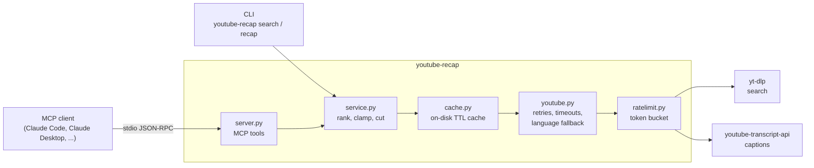

# youtube-recap

[](https://github.com/MarkoStc/youtube-recap/actions/workflows/ci.yml)
[](LICENSE)
[](pyproject.toml)

An [MCP](https://modelcontextprotocol.io) server that lets an AI assistant search YouTube,
pick the most-viewed videos and read their transcripts, so it can answer *"find the best
videos on X and give me a recap"* in one request.

## Why

Assistants cannot watch videos, and pasting transcripts by hand does not scale past one
video. This server gives the assistant three tools that do the retrieval: search, rank,
fetch and trim transcripts. The assistant (for example Claude) writes the summary itself,
so the server needs no API key and no LLM ([ADR 3](docs/adr/0003-client-side-summarization.md)).

| MCP tool | What it does |
| --- | --- |
| `search_videos(query, max_results?)` | Search YouTube; results ranked by view count, with channel and duration |
| `get_transcript(video_id, languages?)` | Full transcript of one video, with language fallback |
| `recap(query, num_videos?, search_pool?)` | Search, keep the most-viewed videos, return their transcripts cut to a length the client can read |

Omitted arguments take their values from the config file.

## Quickstart

Requires [uv](https://docs.astral.sh/uv/) (it installs the right Python).

```sh
git clone https://github.com/MarkoStc/youtube-recap.git && cd youtube-recap
uv sync
claude mcp add youtube-recap -- uv run --directory "$PWD" youtube-recap
```

Then ask Claude: *"Search YouTube for 'how transformers work' and recap the top 2 videos."*
For Claude Desktop, the MCP Inspector and Docker, see [docs/clients.md](docs/clients.md).

No MCP client? The same features work from the command line:

```sh
uv run youtube-recap search "rust ownership explained" -n 2
```

```text
- Understanding Ownership in Rust
  id=VFIOSWy93H0 | views=366,763 | channel=Let's Get Rusty | duration=25:30
  https://youtu.be/VFIOSWy93H0
- Learning Rust: Memory, Ownership and Borrowing
  id=8M0QfLUDaaA | views=104,875 | channel=YouCodeThings | duration=7:46
  https://youtu.be/8M0QfLUDaaA
```

`uv run youtube-recap recap "how transformers work" -n 2` returns each transcript under
a header like this (output captured on 2026-10-14; view counts change):

```text
## Transformers, the tech behind LLMs | Deep Learning Chapter 5
https://youtu.be/wjZofJX0v4M | views=11,420,774 | channel=3Blue1Brown | language=en

(first 8,000 characters of the transcript)

[transcript cut after 8,000 characters]
```

## How it works



- **Ranking**: yt-dlp's flat search returns the first `search_pool` results without loading
  each video page; the service sorts them by view count. "Most viewed" therefore means most
  viewed among those results, not across all of YouTube
  ([ADR 6](docs/adr/0006-rank-within-search-results.md)).
- **Transcripts**: requested languages first; if none exist, YouTube's machine translation,
  then the original language. The output always says which language came back.
- **Limits**: each recap transcript is cut to 8,000 characters by default, and the output
  marks the cut, so the client's context stays bounded.
- **Network**: timeouts, retries with exponential backoff for transient errors, a shared
  rate limit, and an on-disk cache (1 hour for searches, 7 days for transcripts).
- **Config**: every limit lives in one packaged YAML file; override any key with your own
  file ([ADR 5](docs/adr/0005-yaml-config.md)). See all keys with
  `uv run youtube-recap config show`.

Design decisions are recorded in [docs/adr/](docs/adr/README.md).

## Evaluating recap quality

[`evals/`](evals/README.md) holds a fixed set of 6 videos with 54 reference key points and
a harness (`youtube-recap eval`) in which one Claude model writes recaps and another judges
which key points they cover. It compares the recap tool's cut transcripts against full
ones and splits the score by whether a key point lies before or after the cut, to show
what the length limit costs.

No results are published yet: a run needs Claude API credentials, and the reference key
points still need a human review. `evals/README.md` explains how to run it and what the
numbers can and cannot show.

## Project structure

```text
src/youtube_recap/
  server.py        MCP tools (build_server)
  cli.py           command-line interface; no command = run the MCP server
  app.py           wires adapters, cache and rate limiter from config
  service.py       ranking, limits, truncation
  youtube.py       yt-dlp and youtube-transcript-api adapters
  cache.py         on-disk cache and caching adapters
  ratelimit.py     token-bucket rate limiter
  retry.py         retry policy with backoff and jitter
  config.py        typed config; defaults in default.yaml
  formatting.py    text returned to the model
  evaluation/      recap-quality harness (optional `eval` extra)
tests/             pytest suite; YouTube and Claude are faked, no network
evals/             evaluation dataset and results
docs/              client setup and ADRs
```

## Development

```sh
uv sync
uv run pre-commit install
uv run pytest --cov          # tests, no network
uv run mypy                  # strict type check
uv run ruff check . && uv run ruff format --check .
```

CI runs the same checks on Python 3.11, 3.12 and 3.13, builds the Docker image and audits
locked dependencies with `pip-audit`. See [CONTRIBUTING.md](CONTRIBUTING.md) and
[CHANGELOG.md](CHANGELOG.md).

## Roadmap

- Run the evaluation with reviewed key points and publish the results table.
- Cache "no transcript" results for a short time, so repeated recaps skip known misses.
- Include the language fallback mode in the transcript cache key.
- Optional backend on the YouTube Data API for ranking across all of YouTube.
- Streamable HTTP transport, for clients that do not start local processes.

## Author

Marko Stojanovic. Built on [yt-dlp](https://github.com/yt-dlp/yt-dlp),
[youtube-transcript-api](https://github.com/jdepoix/youtube-transcript-api) and the
[MCP Python SDK](https://github.com/modelcontextprotocol/python-sdk).

Licensed under the [MIT License](LICENSE).
